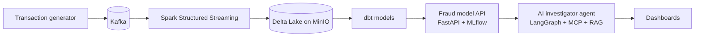

# FraudGuard


A real-time financial-crime platform: banking transactions stream through Kafka and Spark into a lakehouse, a fraud model scores them, and an LLM-powered investigator agent explains suspicious activity.

This is a portfolio project, built in phases, to demonstrate production-style data engineering, MLOps and AI engineering end to end: stream processing, data quality, model deployment and monitoring, AI agents with tool calling, and cloud infrastructure as code. Each phase is runnable on its own.

## Architecture

Target architecture (see [Status](#status) for what's built so far):



## Status

| Phase | Scope | Status |
|---|---|---|
| 0 | Foundation: monorepo, tests, Docker, CI/CD | ✅ Done |
| 1 | Data platform: Kafka → Spark → Delta Lake → dbt | ⏳ Next |
| 2 | ML + MLOps: MLflow, FastAPI, monitoring, A/B test | Planned |
| 3 | AI investigator: LangGraph, MCP, RAG, LLM evaluation | Planned |
| 4 | Cloud: Kubernetes, Terraform, Azure | Planned |
| 5 | Analytics dashboards | Planned |

## Tech stack (so far)

- **Python 3.12** with **uv** workspaces: one monorepo, one lockfile, one package per service
- **Pydantic v2**: transaction data contract with validation at the source
- **pytest** for unit tests; **ruff** for linting and formatting; **pre-commit** hooks
- **Docker** (non-root, cache-friendly layered images) and **Docker Compose**
- **Apache Kafka 4.3** in KRaft mode (no ZooKeeper)
- **GitHub Actions** CI: lint, format check, tests and image build on every push and PR

## Quickstart

Prerequisites: [uv](https://docs.astral.sh/uv/) and [Docker](https://www.docker.com/).

```bash
# Install all dependencies (exact versions from uv.lock)
uv sync --all-packages

# Run the test suite
uv run --all-packages pytest

# Start Kafka locally (wait until `docker compose ps` shows "healthy")
docker compose up -d

# Create the transactions topic
docker compose exec kafka /opt/kafka/bin/kafka-topics.sh \
  --bootstrap-server localhost:9092 --create --topic transactions --partitions 3

# Stop everything
docker compose down
```

## Project structure

```
services/
  generator/          # synthetic transaction generator (Pydantic data contract + tests)
compose.yaml          # local infrastructure (Kafka)
.github/workflows/    # CI pipeline
```

## Engineering practices

- **Data contracts:** every transaction is validated with Pydantic at the source (ID formats, positive amounts with 2 decimal places, timezone-aware timestamps), covered by 22 unit tests including boundary cases.
- **Pre-commit hooks:** ruff linting and formatting plus file hygiene checks run automatically before every commit.
- **CI on every push and PR:** lint, format check, tests, and a Docker build that only runs once the tests pass.
- **Protected `main`:** changes land only via pull requests, and merging requires green CI. No direct pushes or force pushes.
- **Reproducible builds:** pinned dependencies (`uv.lock`), pinned CI actions, and Conventional Commits for a readable history.
