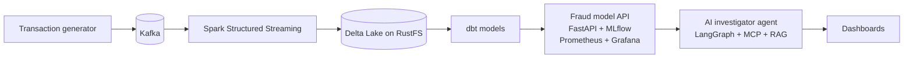

# FraudGuard


A real-time financial-crime platform: banking transactions stream through Kafka and Spark into a lakehouse, a fraud model scores them, and an LLM-powered investigator agent explains suspicious activity.

This is a portfolio project, built in phases, to demonstrate production-style data engineering, MLOps and AI engineering end to end: stream processing, data quality, model deployment and monitoring, AI agents with tool calling, and cloud infrastructure as code. Each phase is runnable on its own.

## Architecture

Target architecture (see [Status](#status) for what's built so far):



## Status

| Phase | Scope | Status |
|---|---|---|
| 0 | Foundation: monorepo, tests, Docker, CI/CD | ✅ Done |
| 1 | Data platform: Kafka → Spark → Delta Lake → dbt | ✅ Done |
| 2 | ML + MLOps: MLflow, FastAPI, monitoring, A/B test | ✅ Done |
| 3 | AI investigator: LangGraph, MCP, RAG, LLM evaluation | ✅ Done |
| 4 | Cloud: Kubernetes, Terraform, Azure | ✅ Done |
| 5 | Analytics dashboards | ⏳ Next |

## Tech stack (so far)

- **Python 3.12** with **uv** workspaces: one monorepo, one lockfile, one package per service
- **Pydantic v2**: transaction data contract with validation at the source
- **pytest** for unit tests; **ruff** for linting and formatting; **pre-commit** hooks
- **Docker** (non-root, cache-friendly layered images) and **Docker Compose**
- **Apache Kafka 4.3** in KRaft mode (no ZooKeeper)
- **GitHub Actions** CI: lint, format check, tests and image build on every push and PR
- **Spark 4.1 Structured Streaming**: Kafka → Delta bronze table, checkpointed (exactly-once)
- **Delta Lake** on **RustFS** (S3-compatible object storage)
- **dbt + DuckDB**: staging and star schema with data-quality tests
- **Make**: one-command pipeline
- **scikit-learn + MLflow 3**: experiment tracking, model registry with `champion` / `challenger` aliases
- **FastAPI**: scoring microservice loading the champion model from MLflow
- **Prometheus + Grafana**: API metrics and a dashboard provisioned as code (throughput, fraud rate, p95 latency)
- **Drift monitoring** with a tested PSI implementation; **A/B testing** with a two-proportion z-test
- **Ollama** (local LLMs, no paid APIs): `qwen3:8b` for the agent, `nomic-embed-text` for embeddings
- **MCP server** (official Python SDK) exposing read-only warehouse tools, with input-validation guardrails
- **Qdrant**: RAG over the bank's (fictional) AML policy
- **LangGraph**: tool-calling investigator agent that writes a verdict with evidence and cited policy rules
- **LLM evaluation**: a fixed test set, deterministic checks (verdict, rules, hallucinated IDs), a local LLM-as-judge, and a model comparison (latency, tokens, estimated API cost), all logged to MLflow
- **MLX-LM LoRA**: a fine-tuned Qwen3-1.7B that learned the policy rules from facts alone (98% vs 52% for the prompted base model)
- **Kubernetes** (kind) and **Helm**: the scoring API as a chart with probes, resource limits, a ConfigMap and rollbacks
- **GHCR**: CI publishes the API image on every merge to `main`, tagged by commit sha
- **Terraform + Azure Container Apps**: the API deployed from the published image with the model baked in, scale to zero, created and destroyed with one command

## Quickstart

Prerequisites: [uv](https://docs.astral.sh/uv/) and [Docker](https://www.docker.com/).
Before the first run: `docker compose up -d storage`, then create a bucket named `lakehouse` at http://localhost:9001/rustfs/console/.

```bash
cp .env.example .env          # then set your own storage password
uv sync --all-packages        # install dependencies (exact versions from uv.lock)
make test                     # run the unit tests
make pipeline                 # Kafka → Spark → Delta → dbt, end to end
docker compose up -d mlflow   # MLflow UI at http://localhost:5050
make train && make promote    # train a model, give the best version the champion alias
docker compose up -d --build scoring-api prometheus grafana
                              # API docs: http://localhost:8000/docs
                              # dashboard: http://localhost:3000/d/fraudguard-api
make drift                    # PSI drift check (exits 1 on significant drift)
make challenger && make ab-test   # train a challenger and run the A/B test
docker compose up -d qdrant   # AI investigator (needs Ollama: ollama pull qwen3:8b nomic-embed-text)
make index-policy             # embed the AML policy into Qdrant
make investigate TX=<transaction_id>
make eval-agent               # score the agent on the test set (MLflow experiment agent-eval)
make k8s-up                   # run the API on a local Kubernetes cluster with Helm (needs kind + helm)
make export-model             # bake the MLflow champion into the API image (for the cloud)
make down                     # stop everything
```

Write-ups: [A/B test](docs/ab_test.md), [LLM comparison](docs/llm_comparison.md), [agent evaluation](docs/agent_eval.md), [LoRA distillation](docs/lora_distill.md), [Azure deployment](docs/azure_deploy.md).

## Project structure

```
services/
  generator/          # synthetic transactions + fraud patterns → Kafka (Pydantic contract, tests)
  streaming/          # Spark Structured Streaming jobs: Kafka → Delta bronze tables
  scoring-api/        # FastAPI scoring service with Prometheus metrics (tests use a fake model)
  investigator/       # MCP server, RAG and the LangGraph investigator agent
knowledge/            # fictional AML policy used for RAG
pipelines/
  dbt/                # dbt staging, star schema and ML training set with data-quality tests
ml/                   # training, gated promotion, drift (PSI), A/B test, LLM comparison and agent eval
infra/                # Prometheus + Grafana config, Helm chart, Terraform for Azure
docs/                 # write-ups: A/B test, LLM comparison, agent eval, LoRA, Azure deploy
compose.yaml          # local stack: Kafka, S3 storage, Spark, MLflow, API, Prometheus, Grafana, Qdrant
Makefile              # one-command pipeline and ML workflow
.github/workflows/    # CI pipeline
```

## Engineering practices

- **Data contracts:** every transaction is validated with Pydantic at the source (ID formats, positive amounts with 2 decimal places, timezone-aware timestamps), covered by unit tests including boundary cases (55 tests across the repo).
- **No label leakage:** fraud labels arrive on a separate topic, days later (chargebacks); features are point-in-time correct and models are evaluated on a time-based split with PR-AUC.
- **Data quality in the warehouse:** 12 dbt tests (not_null, unique, accepted_values, relationships); staging deduplicates Kafka's at-least-once deliveries.
- **Fair model promotion:** a new model becomes `champion` only if it beats the current one on the same, newest test set.
- **Evaluated, not demoed:** prompt and tool changes to the agent are measured on a fixed test set; the deterministic checks are the ground truth and the LLM judge is a secondary signal. Tracing showed most failures came from missing data and tool design, not the prompt.
- **Pre-commit hooks:** ruff linting and formatting plus file hygiene checks run automatically before every commit.
- **CI on every push and PR:** lint, format check, tests, and a Docker build that only runs once the tests pass.
- **Protected `main`:** changes land only via pull requests, and merging requires green CI. No direct pushes or force pushes.
- **Reproducible builds:** pinned dependencies (`uv.lock`), pinned CI actions, and Conventional Commits for a readable history.
