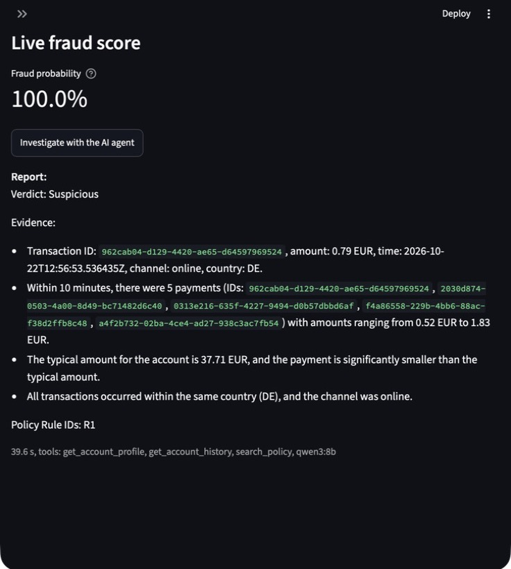

# Fraud dashboard

**Question:** can one screen give a fraud analyst the whole picture: overall fraud trends, and for a single payment, the facts, the model's score and an AI investigation?

## Run it

```bash
make dbt                               # builds the agg_daily_fraud mart
open -a Ollama                         # the agent's LLM runs on the Mac
docker compose up -d --build dashboard # also starts scoring-api, mlflow and qdrant
```

Open http://localhost:8501. To run it without Docker, use `make dashboard`.

## Pages

- **Overview** reads the dbt mart `agg_daily_fraud` (one row per UTC day, channel and country): KPI tiles, the fraud rate per day, and frauds by channel and by country.
- **Transaction explorer:** enter a transaction ID to see:
  - the payment and the account's profile before it (point in time)
  - a live score from the scoring API
  - an "Investigate" button that runs the LangGraph agent



## Design choices

- **The business logic lives in dbt, not in the UI.** The mart is tested: a singular test checks that it counts every payment in `fct_transactions` exactly once. Days are in UTC, so they are the same on every machine.
- **The fraud rate is weighted:** total frauds divided by total transactions. Averaging the per-row rates would let a row with 3 payments count as much as one with 3,000. A unit test checks this.
- **No training/serving skew:** the features sent to the model come from `ml_training_set`, the table it was trained on, and are not recomputed in the UI.
- **The dashboard reuses the investigator package** as a uv workspace dependency instead of copying its functions.
- **Graceful degradation:** if the scoring API is down, the explorer shows a warning and still shows the facts and runs the agent.
- **Read-only:** the warehouse is opened `read_only=True` and mounted `:ro` in Docker.

## Bugs found on the way

| Symptom | Cause | Fix |
|---|---|---|
| Unit test failed on `Decimal('1.20')` | `amount` is `DECIMAL(12,2)`, which JSON cannot serialize, so scoring would have crashed | Cast to double at the API boundary; the test fixture uses the real column types |
| Agent failed in Docker: `MCPError: Connection closed` | MCP starts its server with only a safe subset of env vars, so `WAREHOUSE_PATH` never arrived; on the Mac the default path happened to exist | Pass only `WAREHOUSE_PATH` to the server (least privilege) |
| `No module named 'pytz'` in Docker | DuckDB needs `pytz` for timestamps with a time zone but does not declare it; it was installed locally by another group | Declare `pytz` in the investigator package |
| `Name or service not known` | `OLLAMA_HOST` pointed to `ollama`, which is not a Compose service | `host.docker.internal`, because Ollama runs on the Mac |
| Agent could not reach Qdrant or Ollama from a container | Hosts were hard-coded to `localhost` | `QDRANT_URL` and `OLLAMA_HOST` env vars with local defaults |

## Honest limitations

- The investigation takes 40–50 s with a local 8B model. The spinner says so, but a real analyst tool would run it in the background or use a faster model.
- LLM output varies between runs. On the same card-testing payment, one run listed 8 payments in 10 minutes and another listed 5, which does not meet R1's "more than 5", and that run wrote `Policy Rule IDs: R1` instead of the required `Rules:` line. The verdict was right both times, but this is why the agent evaluation runs each case several times and why the report is advice for an analyst, not an automatic decision.
- There is no login. The dashboard is a local demo, not something to expose publicly.
